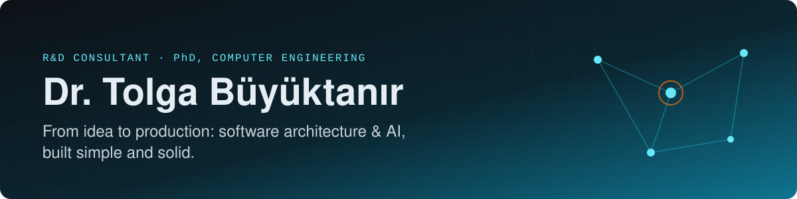

  

  
  
  
  
  

I'm an **R&D consultant** with a PhD in computer engineering. For more than ten years I've led R&D in **machine learning, big data, computer vision and fintech**, turning ideas into live products: a smart caching system used by Kahve Dünyası and Vodafone Yanımda, [NUYA](https://gonuya.com/), a platform behind seven brands, and [CodeBody](https://codebody.com.tr/), which I built for wellness centers.

If you're weighing an architecture decision or bringing AI into a product, [a few sentences are all it takes](https://tolgabuyuktanir.github.io/#contact).

<table>
  <tr>
    <td align="center" width="25%"><h3>10+</h3>years in R&D</td>
    <td align="center" width="25%"><h3>8</h3>TÜBİTAK-funded projects</td>
    <td align="center" width="25%"><h3>20+</h3>papers, books & talks</td>
    <td align="center" width="25%"><h3>6</h3>tech companies, in R&D roles</td>
  </tr>
</table>

## 🧭 Where I can help

| | |
|---|---|
| **Software architecture & product** | Multi-tenant SaaS, service boundaries, data modelling, security and access control |
| **AI & product integration** | Finding where AI adds real value, then choosing, integrating and measuring the model |
| **Local & cloud LLMs** | On-prem and air-gapped deployments, cloud models, one provider layer across both |
| **GenAI, agents & RAG** | Knowledge bases from your documents (incl. OCR), tool-using agents, assistants in workflows |
| **LLM safety & evaluation** | Authorization-aware context, prompt-injection guards, human hand-off, eval sets |
| **Big data & data engineering** | Stream processing and pipelines on Spark, Kafka and Hadoop |
| **Computer vision, speech & robotics** | 6-DoF pose estimation, posture analysis, Turkish ASR, robot arms, embedded models |
| **R&D & grant consulting** | TÜBİTAK TEYDEB (1501/1507) and ARDEB proposals |

## 🚀 Featured work

| Project | What it is |
|---|---|
| [**CodeBody**](https://codebody.com.tr/) | AI-powered SaaS for wellness centers: posture analysis (MediaPipe, YOLO, SAM), voice notes → session summaries (Whisper), an MCP-backed assistant. I architected and built it end to end. |
| [**NUYA**](https://gonuya.com/) | One multi-tenant core powering seven brands: a versioned scoring engine, PostgreSQL RLS, authorization-first AI chat and a real-time voice AI coach. Lead engineer. |
| [**Crowbar**](https://github.com/tolgabuyuktanir/CrowbarDemoApp) | Smart caching & prefetching, the subject of my PhD thesis: models user navigation with PrefixSpan, LSTMs and graph embeddings. Used by Kahve Dünyası and Vodafone Yanımda. [Live demo](https://huggingface.co/spaces/tbuyuktanir/CrowbarDemoApp) |
| [**concrete-fhe-toolkit**](https://github.com/tolgabuyuktanir/concrete-fhe-toolkit) | Privacy-preserving ML on Zama Concrete: train decision trees, random forests and K-Means on encrypted data. On [PyPI](https://pypi.org/project/concrete-fhe-toolkit/). |
| [**AskAboutIslam & AskMariam**](https://askaboutislam.ai/) | A social impact project: an AI assistant that answers in 20+ languages with cited sources, by text, voice and a talking-head video avatar, all on one RAG pipeline. |

More, from robot arms to an award-winning e-scooter, in the [portfolio](https://tolgabuyuktanir.github.io/#projects).

## 🧰 Toolbox

  
  
  
  
  
  
  
  
  

  
  
  
  
  
  
  
  
  
  
  
  

## 🧑‍💻 Experience

- **2024 – now · R&D Consultant.** Software architecture, AI and product integration, fintech and TÜBİTAK projects; NUYA, CodeBody, AskAboutIslam.
- **2020 – 2024 · R&D Technical Lead, Loodos R&D Center.** Bin-picking robotics, 6D pose estimation, voice-controlled robots, an AI braking system for e-scooters, smart caching, RL-based load testing.
- **2018 – 2020 · R&D Engineer, İdea Teknoloji.** Time series, NLP, multi-document summarization, stream processing.
- **2018 · R&D Engineer, Huawei Turkey R&D and Link Bilgisayar.** CloudSearch; Kafka/Gobblin/Spark pipelines.
- **2014 – 2017 · Research Assistant, Turgut Özal University,** then freelance big data, Java and IoT development.

## 📚 Selected publications

- **On the Use of Embedding Techniques for Modeling User Navigational Behavior in Intelligent Prefetching Strategies.** *Concurrency and Computation: Practice and Experience*, Wiley, 2025.
- **Predictive Prefetching in Client-Server Systems: A Navigational Behavior Modeling Approach.** [*IJSEKE*](https://www.worldscientific.com/doi/10.1142/S0218194024500384), 2024.
- **A Deep Learning-based Prefetching Approach to Enable Scalability for Data-intensive Applications.** [*IEEE BigData*](https://ieeexplore.ieee.org/document/10020591), 2022.
- **Mobile Prefetching and Web Prefetching: A Systematic Literature Review.** [*ICCSA*, Springer LNCS](https://link.springer.com/chapter/10.1007/978-3-031-10545-6_6), 2022.

Full list on [Google Scholar](https://scholar.google.com/citations?user=D2Md-J4AAAAJ) and the [website](https://tolgabuyuktanir.github.io/#research).

## 📊 GitHub activity

  
  

  

  

Cards are generated daily by a [GitHub Action](.github/workflows/profile-cards.yml) in this repository, so they never depend on a third-party service.
